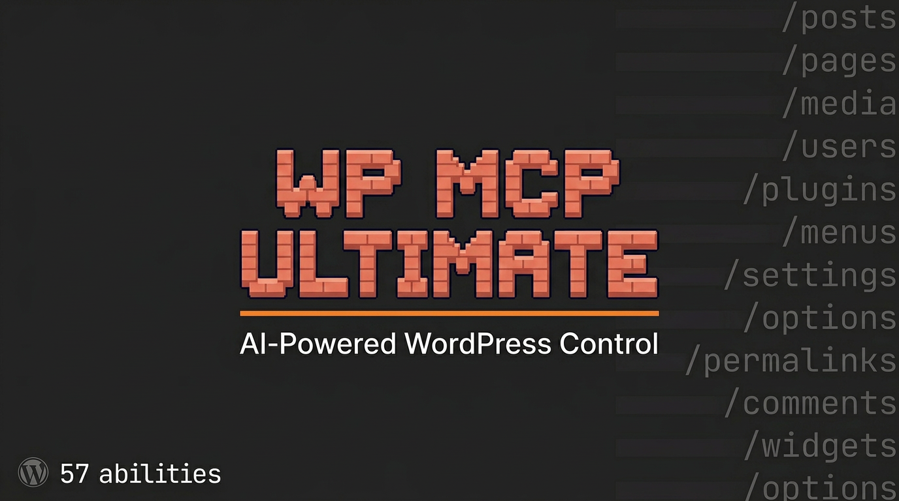

# WP MCP Ultimate

> **Blog:** [Full setup guide and demo](https://agricidaniel.com/blog/wp-mcp-ultimate-wordpress-ai-plugin)

Connect WordPress to AI in one click. A self-contained MCP (Model Context Protocol) server plugin with 58 WordPress abilities -- manage posts, pages, media, users, plugins, menus, comments, and more through any MCP-compatible AI client. No other plugins needed.

## Quick Start

1. **Install the plugin**: Upload the zip file via Plugins > Add New > Upload Plugin, or clone this repository into `wp-content/plugins/`.
2. **Generate an API key**: Go to Tools > MCP Ultimate in your WordPress admin and click Generate to create an Application Password.
3. **Configure your AI client**: Copy the MCP server config snippet shown on the dashboard into your AI client's configuration file.

> **Authentication:** Application Passwords work everywhere. For clients that require OAuth (Claude Web custom connectors, Claude Mobile), the plugin also bundles an OAuth 2.1 authorization server with PKCE and dynamic client registration -- point the connector at the MCP endpoint and it discovers everything automatically. See the [Setup Guide](docs/SETUP.md). By default, reaching the MCP endpoint requires the `edit_posts` capability (filterable), and plugin installs no longer auto-activate; both are covered in [SECURITY.md](SECURITY.md).

## Features

- 58 WordPress abilities covering content, media, users, plugins, menus, widgets, comments, options, and system management
- MCP protocol v2025-06-18 compliance
- Streamable HTTP transport
- Application Password auth **and** a bundled OAuth 2.1 server (PKCE + dynamic client registration) for Claude Web/Mobile connectors
- Admin dashboard with API key management, one-click generation, and connection testing
- Config export snippets for Claude Code, Claude Desktop, and Cursor
- Conflict detection for legacy plugins (MCP Adapter, MCP Expose Abilities, Abilities API)
- Abilities API polyfill for WordPress < 6.9

## Requirements

- PHP 8.0 or higher
- WordPress 6.7 or higher

## Documentation

- [Setup Guide](docs/SETUP.md) -- Detailed installation and configuration instructions
- [Abilities Reference](docs/ABILITIES.md) -- Complete list of all 58 abilities with descriptions and required capabilities

## Credit

Built on work from the WordPress AI team, MCP Adapter, and MCP Expose Abilities plugins.

## Contributing

PRs welcome. Please open an issue first to discuss.

## License

GPL-2.0-or-later. See [LICENSE](LICENSE) for the full text.

---

## Author

Built by [Agrici Daniel](https://agricidaniel.com/about) - AI Workflow Architect.

- [Blog](https://agricidaniel.com/blog) - Deep dives on AI marketing automation
- [AI Marketing Hub](https://www.skool.com/ai-marketing-hub) - Free community, 2,800+ members
- [YouTube](https://www.youtube.com/@AgriciDaniel) - Tutorials and demos
- [All open-source tools](https://github.com/AgriciDaniel)
